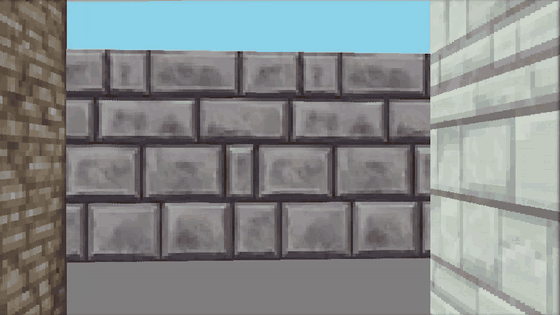

# cub3D

A 42 school project: a small first-person maze explorer built with raycasting, in the spirit of Wolfenstein 3D. Written in C with the MiniLibX.



## Features

- Raycasted 3D view with a different wall texture for each side (N/S/E/W)
- Custom floor and ceiling colors
- Smooth movement and wall collisions
- Render any map which meet requirements
- Map parsing and validation (closed walls, valid characters, a single player spawn)

## Build & run

```sh
make
./cub3d maps/real_map.cub
```

## Controls

| Key            | Action             |
| -------------- | ------------------ |
| `W` / `S`      | Move forward / back |
| `A` / `D`      | Strafe left / right |
| `←` / `→` (or `J` / `K`) | Turn left / right |
| `Esc`          | Quit               |

## Map format

A `.cub` file holds the textures, the colors, and then the map:

```
NO textures/wall1.xpm
SO textures/wall2.xpm
WE textures/wall3.xpm
EA textures/wall4.xpm

F 128, 128, 128
C 135, 206, 235

111111
100101
1000N1
111111
```

`1` is a wall, `0` is empty floor, and `N`/`S`/`E`/`W` sets where the player starts and which way they face. The map has to be fully enclosed by walls. More examples are in [`maps/`](maps/).
